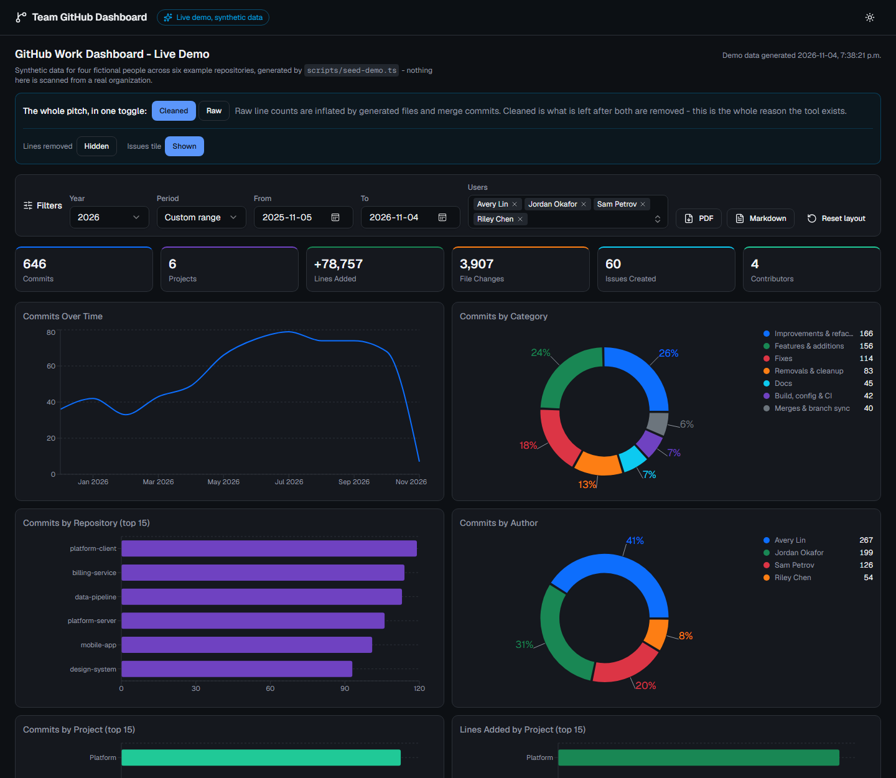
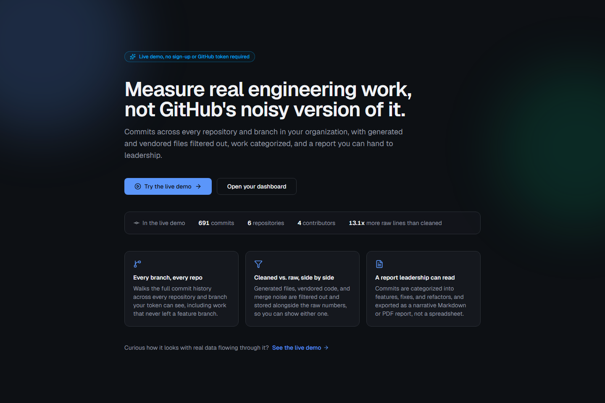
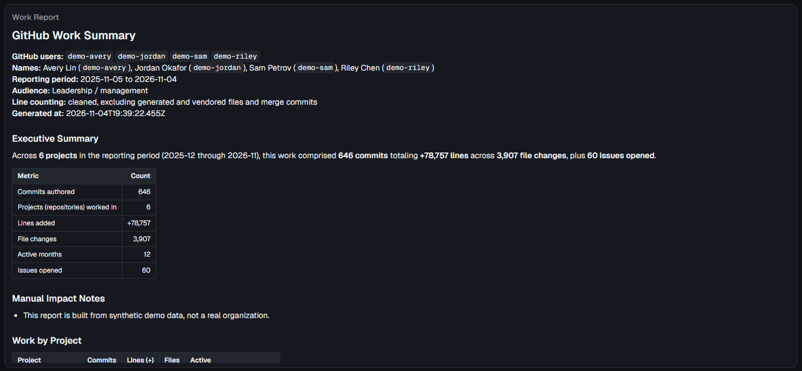

# Team GitHub Dashboard

Measure real engineering work across every repository and branch in a GitHub
organization, with generated-file noise removed, work categorized, and a report
you can hand to leadership.



<table>
  <tr>
    <td width="50%"></td>
    <td width="50%"></td>
  </tr>
  <tr>
    <td align="center"><sub>The homepage</sub></td>
    <td align="center"><sub>The work report, built from stored data with no GitHub calls</sub></td>
  </tr>
</table>

<sub>All screenshots are of <code>/demo</code>: four fictional people across six
example repositories, generated by <code>scripts/seed-demo.ts</code>. No real
organization's data is shown.</sub>

## See it without a token

`/demo` is a public, unauthenticated page showing the dashboard against a
synthetic dataset - no GitHub organization, token, or database access
required. It reads from an isolated SQLite file
(`data/demo.sqlite`, regenerated by `npm run seed-demo -- --target sqlite`,
see [docs/ARCHITECTURE.md](docs/ARCHITECTURE.md#storage-layer)), never the
real `DATABASE_URL`, and every route under it is read only: there is no
scan, settings, or token endpoint reachable at `/api/demo/*`.

## The problem

GitHub's own views cannot answer the question most engineering managers actually
ask: *how much real work did this person, or this team, do across everything we
own, over an arbitrary time range, with the noise removed?*

That is not a gap someone forgot to fill. It follows from what GitHub is:

- **Everything is scoped to one repository.** Insights, Code Frequency, and
  Contributors all live inside a single repo. There is no native "show me this
  engineer's output across all 85 repositories we own".
- **The contribution graph is not a measure of work.** It counts events, mostly
  on default branches, only for commits whose author email is linked to the
  account, and it weights a typo fix the same as a 2,000 line feature.
- **Line counts are inflated and cannot be filtered.** Code Frequency counts raw
  additions and deletions, including `package-lock.json`, `dist/`, minified
  bundles, and merge commits, which re-show a diff already counted. One
  dependency bump can add tens of thousands of "lines". There is no setting to
  exclude any of it.
- **Search only indexes default branches.** A team that develops on `develop` or
  on feature branches is substantially invisible.

## What this does instead

- **Walks every branch of every repository** through the Commits API, so work on
  unmerged feature branches is counted.
- **Computes cleaned and raw line statistics** for every commit and stores both.
  Cleaned excludes generated and vendored paths and counts merge commits as
  zero. On real data the gap is large: one author's year reads **+178,796
  cleaned against +419,311 raw**, so the raw figure is more than double and
  almost entirely noise.
- **Categorizes each commit** from its message into features, fixes, refactors,
  removals, build and CI, docs, and merges, so the breakdown shows the *shape*
  of the work, not only its volume.
- **Attributes commits by login, email, and name**, so work committed with an
  unlinked `git config user.email` is not lost.
- **Survives the rate limit.** The scan tracks the remaining quota per resource,
  stops cleanly at a floor with partial results rather than freezing, and
  records a checkpoint so a scope too large for one hour finishes across
  several runs.
- **Exports** the whole thing as PDF or Markdown, timestamped.

## Quick start

```bash
npm install
cp .env.example .env.local     # then fill in DATABASE_URL and AUTH_SECRET
npm run db:migrate
npm run seed-demo              # synthetic data, so you can see it working
npm run create-user -- --email you@example.com --role admin
npm run dev
```

Open <http://localhost:3000/github>.

To use real data instead of the demo seed, put a GitHub token in `.env.local`,
fill in `config/scan.json`, and run `npm run scan`.

### Requirements

- Node 20 or newer.
- A Postgres database. [Neon](https://neon.tech) has a free tier that is more
  than large enough; any Postgres works.
- A GitHub token, only for scanning. Reading an already-populated dashboard
  needs no token at all.

## Configuration

Two files, split along whether the contents are secret.

**`config/scan.json`** is committed. It holds the scan scope: tracked handles,
display names, branch policy, the rate-limit floor, and the ignore globs. It is
in git on purpose, so a reviewer can see when the tracked roster changed. Every
field has a default, so a missing or partial file still starts.

**`.env.local`** is not committed. See `.env.example` for every variable.

| Variable | Purpose |
|---|---|
| `DATABASE_URL` | Postgres connection string |
| `AUTH_SECRET` | Session signing key, at least 32 bytes |
| `AUTH_ENABLED` | Set to `false` to disable sign-in entirely. See [docs/AUTH.md](docs/AUTH.md) |
| `GITHUB_TOKEN` | Personal access token, needed only for scanning |
| `GITHUB_ORGS` | Organizations to scan, comma separated |
| `GITHUB_USER_ACCOUNTS` | Personal accounts to scan, comma separated. Additive with `GITHUB_ORGS`, not a replacement for it |

A classic token needs `repo`, and `read:org` only if `GITHUB_ORGS` is set. A
fine-grained token needs Contents and Metadata read; scanning an organization
also needs Organization → Members read, with the resource owner set to the
organization itself, or member listing returns an empty `200` rather than an
error. A personal-account scope has no equivalent "members" concept, so that
requirement only applies when `GITHUB_ORGS` is in use. Seeing a personal
account's *private* repositories additionally requires the token to belong to
that same account.

## Commands

```bash
npm run dev            # development server
npm run build          # production build
npm run lint           # ESLint
npm run typecheck      # tsc --noEmit

npm run db:generate    # generate a migration from the schema
npm run db:migrate     # apply migrations
npm run db:studio      # browse the database

npm run scan           # scan GitHub and store the results
npm run scan -- --users Relatora --start 2026-08-01 --end 2026-08-27
npm run scan -- --rebuild-cache        # re-list org repositories as well as branches
npm run enrich         # backfill line statistics without a full scan

npm run create-user -- --email you@example.com --role admin
npm run seed-demo      # synthetic data
npm run import-mongo   # one-off migration from the Python tool's MongoDB
npm run verify-invariants  # check the never-clobber rule against a live database
```

`npm run scan` exits **2** when the rate-limit budget stopped it early, so a
scheduler can tell "partial, run again after the quota resets" apart from both
success and hard failure.

## Roles

`viewer`, `developer`, `admin`, additive in that order.

- **viewer** sees the dashboard and can export.
- **developer** also gets the settings panel (cleaned versus raw counting, the
  lines-removed toggle, the shown-users whitelist), can start scans, and can
  fetch organization members not yet in the data.
- **admin** is reserved for account management.

Scanning is gated behind `developer` because it spends the organization's GitHub
API quota.

## Where things are

| Path | What |
|---|---|
| `lib/github/` | The scanner: client, discovery, branch walk, categorization, statistics, enrichment |
| `lib/db/` | Drizzle schema and the repository layer |
| `lib/metrics/` | The dashboard aggregation |
| `lib/report/` | Markdown report builder |
| `lib/auth/` | Authentication, behind a three-function facade |
| `components/github/` | The dashboard |
| `scripts/` | CLI entry points |

## Further reading

- [docs/NEON_SETUP.md](docs/NEON_SETUP.md) - getting a database connection
  string, step by step, and which free-tier limits you will actually notice.
- [docs/DEPLOYMENT.md](docs/DEPLOYMENT.md) - Docker, Vercel, scheduled scans,
  and the one constraint that decides the deployment shape.
- [docs/ARCHITECTURE.md](docs/ARCHITECTURE.md) - how a scan flows through the
  system, and the invariants that must survive future changes.
- [docs/AUTH.md](docs/AUTH.md) - the auth design, the kill switch, and its known
  limits.
- [docs/PORTING.md](docs/PORTING.md) - what came from where, what was
  deliberately dropped, and the traps that cost real debugging time in the
  original.
- [docs/MONETIZATION.md](docs/MONETIZATION.md) - licensing, packaging, pricing,
  and the compliance constraints on selling developer metrics.

## A note on what this measures

Commit counts and line totals describe activity, not value. Cleaned counting
makes them far less misleading than the raw numbers GitHub shows, but no
automated measure knows that a 20 line fix to a race condition was the hardest
work anyone did that quarter.

Use this to see where effort went and to make invisible work visible. Do not use
it to rank people. `docs/MONETIZATION.md` covers why that is also a legal
constraint in several jurisdictions, not only an ethical one.
